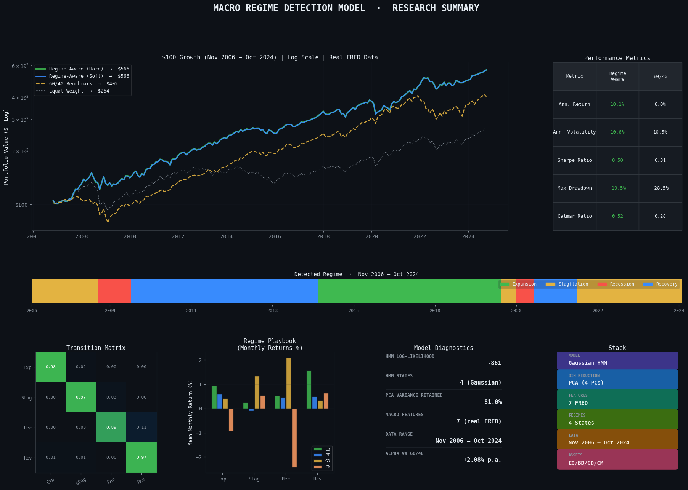
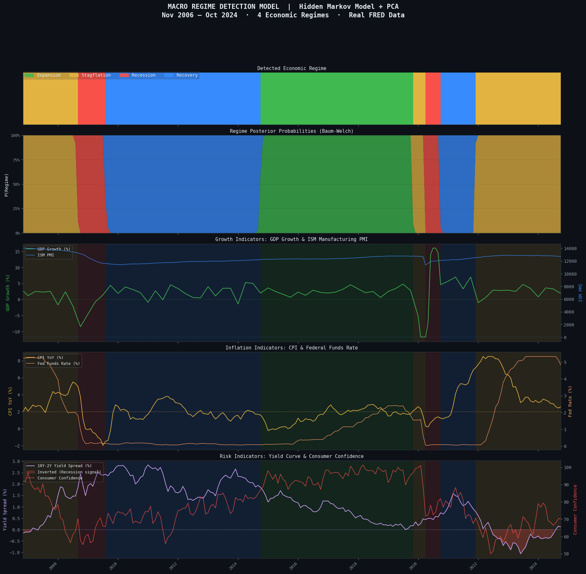
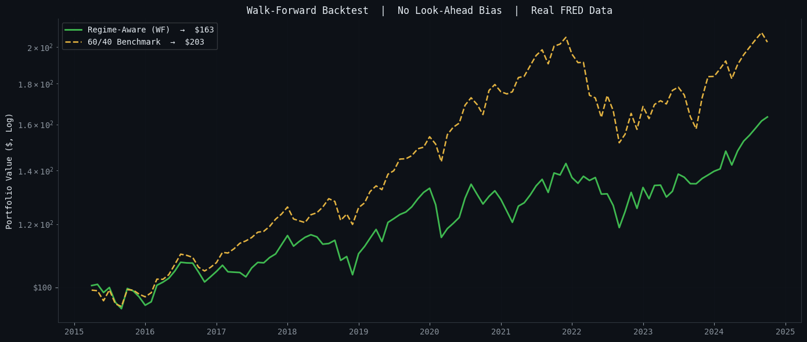
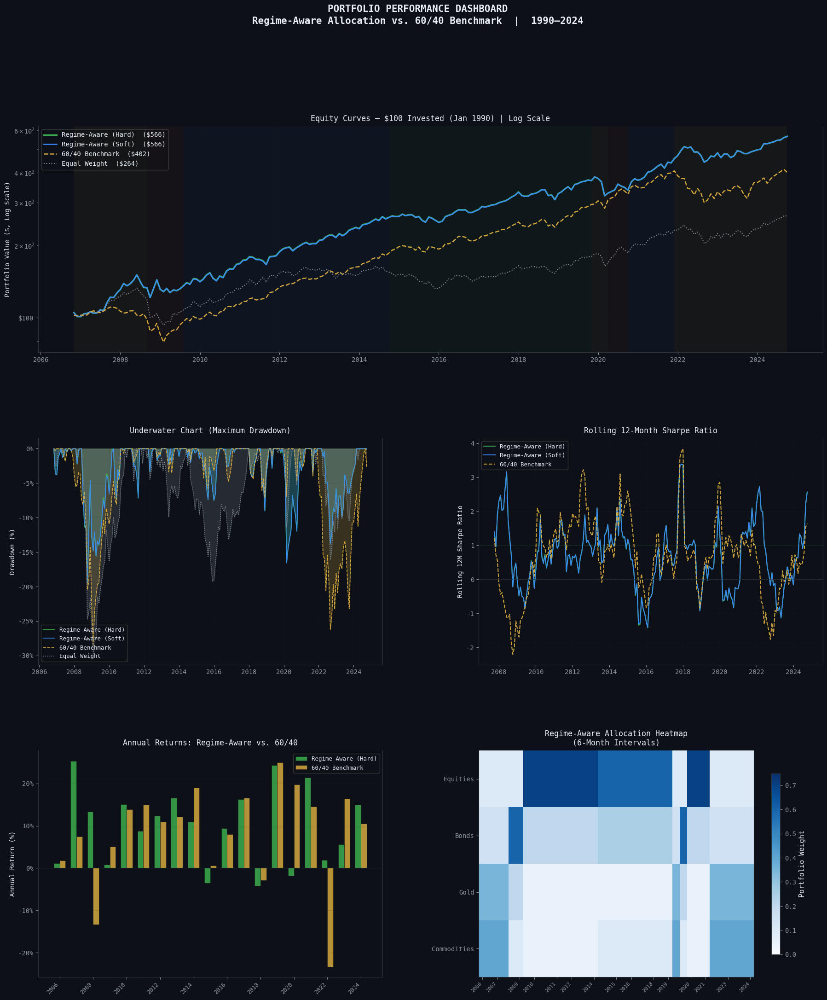
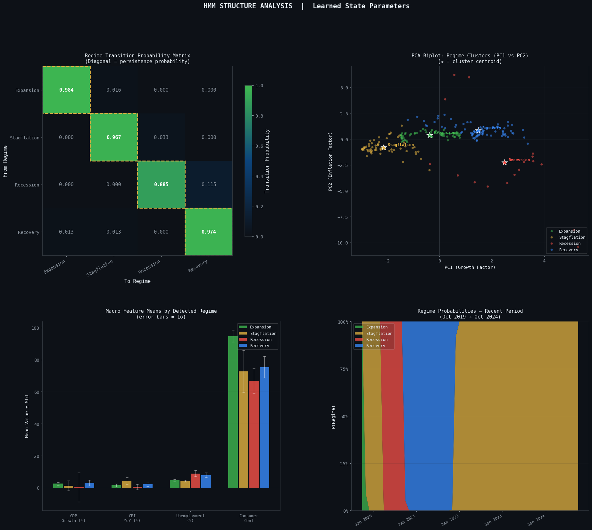
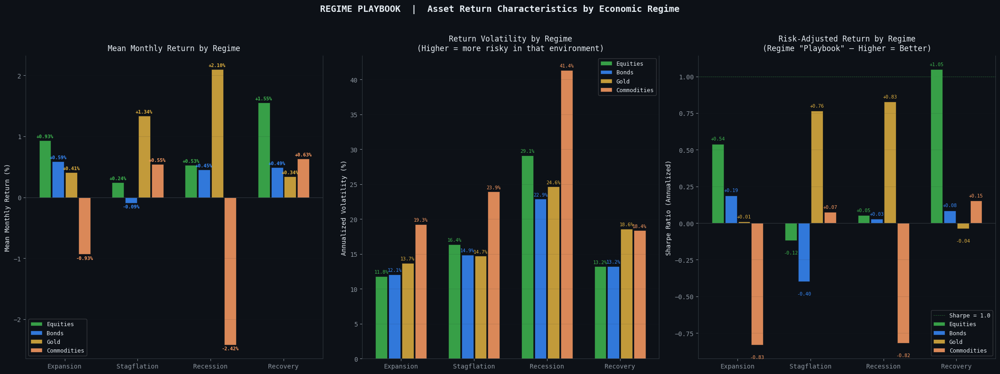
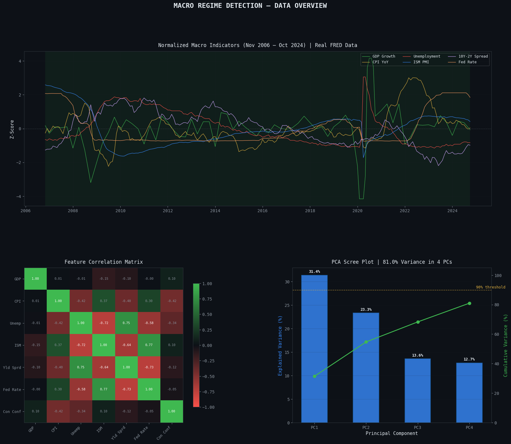
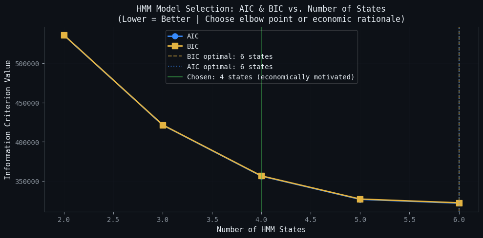

# HMM Macro Regime Detection

[](https://colab.research.google.com/github/SebastianIWright/hmm-macro-regime-detection/blob/main/macro_regime_detection.ipynb)

📄 **[Read the 2-page research note (PDF)](HMM_research_note.pdf)** for the question, method, results, and takeaways.


A 4-state Hidden Markov Model that reads the US economy from FRED data, labels each month as **Expansion, Stagflation, Recession, or Recovery**, and uses those labels to shift a multi-asset portfolio between stocks, bonds, gold, and commodities.



## The Question

Asset classes behave very differently depending on where we are in the economic cycle. Bonds rally in recessions, commodities do well in inflation, and equities lead in expansions. The problem is that nobody announces the regime in real time. This project asks: can a statistical model spot the regime from macro data alone, and does knowing it actually improve a portfolio?

## How It Works

1. **Data pipeline.** Pulls 8 macro series from FRED (real GDP growth, CPI, unemployment, manufacturing employment, 10Y-2Y spread, Fed Funds, HY credit spread, consumer sentiment) and monthly returns for SPY, TLT, GLD, and GSG from Yahoo Finance.
2. **Feature engineering.** Winsorizes outliers, adds 3-month momentum features, standardizes, then runs PCA (11 features down to 4 factors, 81% of variance kept).
3. **Regime model.** Fits a Gaussian HMM with full covariance and 10 random restarts. Each hidden state is mapped to an economic regime by its average GDP, CPI, and unemployment.
4. **Regime-aware allocation.** Each regime gets its own target weights. The portfolio is rebalanced monthly, net of 10 bps transaction costs.
5. **Walk-forward test.** The model is retrained every 6 months on a rolling 100-month window and only ever trades on data it could have seen at the time.
6. **Weight optimization test.** Tests whether learning the regime weights from data beats setting them by economic logic.
7. **Model selection.** AIC/BIC across 2 to 6 states to justify the 4-state choice.

## Key Results



**Detected regimes (Nov 2006 to Oct 2024)**

| Regime | Avg GDP | Avg CPI | Avg Unemp. | Share of Months | Expected Duration |
|---|---|---|---|---|---|
| Expansion | +2.5% | 1.5% | 4.5% | 28% | 61 months |
| Stagflation | +1.3% | 4.3% | 4.1% | 29% | 30 months |
| Recession | +0.3% | 0.6% | 8.9% | 8% | 9 months |
| Recovery | +3.0% | 2.2% | 7.8% | 35% | 38 months |

**Full-sample backtest (net of costs)**

| Metric | Regime-Aware | 60/40 | Equal Weight |
|---|---|---|---|
| Ann. Return | 10.1% | 8.0% | 5.6% |
| Sharpe Ratio | 0.50 | 0.31 | 0.07 |
| Max Drawdown | -19.5% | -28.5% | -29.8% |
| Calmar Ratio | 0.52 | 0.28 | 0.19 |

**Walk-forward backtest (out-of-sample, Apr 2015 to Oct 2024)**

| Metric | Regime-Aware | 60/40 |
|---|---|---|
| Ann. Return | 5.3% | 7.7% |
| Sharpe Ratio | 0.55 | 0.71 |
| Max Drawdown | -16.9% | -26.2% |

## What I Learned

The full-sample numbers look great, but they are fit on the same data they are scored on. Once the model only gets to see the past (walk-forward), the return edge over 60/40 goes away. What survives is the risk side: the regime strategy still cut max drawdown by about 9 points. I also found that hand-set regime weights based on economic logic beat weights learned from the data out of sample, which makes sense with only a few recessions to learn from. Being able to show that gap honestly is the main point of the project.

## Charts

| | |
|---|---|
|  |  |
|  |  |
|  |  |

## Usage

1. Get a free API key from [FRED](https://fred.stlouisfed.org/docs/api/api_key.html).
2. Open `macro_regime_detection.ipynb` in Google Colab and add the key as a Colab secret named `FRED_API_KEY` (or set it as an environment variable when running locally).
3. Run all cells top to bottom.

```
pip install -r requirements.txt
```

## Tech Stack

Python, hmmlearn, scikit-learn (PCA, StandardScaler), pandas, NumPy, SciPy, statsmodels, fredapi, yfinance, Matplotlib/Seaborn.

## Disclaimer

Educational and portfolio project. Not investment advice.
